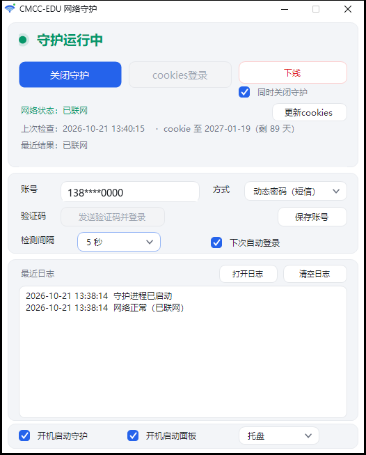

# CMCC-EDU 网络守护

[](#vibecoding-声明)
[](#)
[](#)
[](LICENSE)

中国移动校园网（CMCC-EDU）Portal 自动认证 + 断网守护。单个 exe，不用安装，不用 PowerShell。

**特色：支持 Portal 的「自动登录」Cookie 免密认证**——认证一次之后，后续断网恢复不需要密码、不需要验证码、也不用人点按钮。



---

## ⚠️ 先读这个

这是一个 **vibecoding** 项目：代码由 AI 在对话中生成，人类负责提需求、做判断、跑测试。**没有经过安全审计，没有单元测试**，只在一种环境验证过。

细节见 [VIBECODING.md](VIBECODING.md)。

---

## 运行环境

| 系统 | 需要安装什么 |
| --- | --- |
| Windows 11 | 什么都不用装（自带 .NET Framework 4.8+） |
| Windows 10 1903 及以上 | 什么都不用装 |
| Windows 10 1809 及更早 | 一般能直接跑；报错时装 .NET Framework 4.8 |
| Windows 8.1 / 7 | 需手动装 .NET Framework 4.x |

程序只依赖 .NET Framework 的基础类库，**没有第三方依赖，没有 dll 目录**。

> exe 未做代码签名，首次运行可能弹 SmartScreen「Windows 已保护你的电脑」，点「更多信息 → 仍要运行」即可。

---

## 功能

| 功能 | 说明 |
| --- | --- |
| **静态密码登录** | 填一次密码，之后完全自动 |
| **动态密码登录** | 每次认证时触发短信，输 6 位验证码 |
| **Cookie 免密** | 勾选过「自动登录」后，认证只需一个 GET，无人值守；登录一次自动续期 90 天 |
| **断网守护** | 探测到断网自动恢复，网络事件唤醒 + 轮询兜底 |
| **下线** | 等价于登录页的下线按钮；可勾选「同时关闭守护」，避免下线后几秒又被登回去 |
| **开机自启** | 守护和面板两个独立任务，面板可选托盘或任务栏 |
| **托盘常驻** | 关闭窗口收进托盘，守护继续跑；再双击桌面图标会把面板叫回来 |

---

## 快速开始

### 1. 准备

- Windows 10 / 11
- 已连接 `CMCC-EDU` 热点

把整个目录解压到任意位置（`assets` 子目录必须一起）。

### 2. 启动

双击 **`CMCC-EDU网络守护.exe`**。

> 面板打开后会自动开启守护。首次运行会自动生成 `config.json`。

**想要桌面快捷方式**：面板收进托盘后，右键托盘图标 →「创建桌面快捷方式」。

### 3. 配置

1. 填手机号
2. 选登录方式
   - **动态密码**：不用填密码，点「发送验证码并登录」，输短信码（这个按钮跳过 cookie，直接走短信）
   - **静态密码**：填密码，之后全自动
3. 点「保存账号」
4. 守护会自动运行；想手动控制就点「开启守护 / 关闭守护」

### 4. 想要真正免密

**不需要手动操作。** 用动态密码成功登录一次（登录时会自动勾选「自动登录」），程序会把服务端下发的 4 个 `AUTOAUTH_*` cookie **自动加密保存**进 `config.json`，同时把到期日记在 `autoCookiesExpire`。

这批 cookie 的有效期是「登录时刻 + 90 天」。面板的网络状态后面会显示剩余天数：

```
网络状态：已联网    ·  cookie 至 2027-01-19（剩 89 天）
```

偶尔用短信登录一次，到期日就会自动往后滚 90 天，不需要再做任何手工操作。

<details>
<summary>应急：自动保存失效时怎么手动填入（一般用不到）</summary>

手动把服务端下发的 4 个 `AUTOAUTH_*` cookie 填进 `config.json` 的 `autoCookies`：

```json
"autoCookies": "AUTOAUTH_USERNAME_UNIVERSITY=...; AUTOAUTH_VALPERIOD_UNIVERSITY=...; AUTOAUTH_BOOKTIME_UNIVERSITY=...; AUTOAUTH_APPLYID_UNIVERSITY=..."
```

**怎么拿到这些值**：登录成功后它们会写进 `auth_headers.log`，但默认**只显示前 4 位**（防止可用的凭据落盘）。

需要取完整值时，在 `config.json` 里临时加一行：

```json
"dumpCookies": true
```

再登录一次，`auth_headers.log` 里就是完整值了。**取完记得删掉这一行**。

</details>

机制说明见 [DESIGN.md 第 0.5 节](DESIGN.md)。

---

## 配置说明

`config.json`（首次运行自动生成）：

| 字段 | 说明 |
| --- | --- |
| `ssid` | 目标 Wi-Fi 名，默认 `CMCC-EDU` |
| `portal` | Portal 地址，**可留空**：留空时程序从 AC 的重定向里自动识别 |
| `acName` | 接入控制器名，**可留空**：留空时从重定向参数 `wlanacname` 自动识别 |
| `usernameEnc` | 手机号，DPAPI 加密 |
| `passwordEnc` | 静态密码，DPAPI 加密（动态模式为空） |
| `loginMode` | `static` 或 `dynamic`（默认 `dynamic`） |
| `autoCookiesEnc` | 4 个 `AUTOAUTH_*` cookie，DPAPI 加密（登录成功后自动更新） |
| `autoCookiesExpire` | 上述 cookie 的到期时间，登录成功后自动写入，面板据此显示剩余天数 |
| `autoload` | `checked` 续期自动登录 / `test` 不续期 |
| `interval` | 探测间隔（秒） |
| `guiStartMode` | `tray` 或 `taskbar` |
| `dumpCookies` | 可选调试开关：`true` 时 `auth_headers.log` 写完整 cookie（默认关闭；正常使用不需要） |

**关于凭据加密**：手机号、密码、自动登录 cookie 都用 Windows DPAPI 加密后存储，文件里只有 `dpapi:AQAAANCMnd8...` 这样的密文。

- ✅ 配置文件泄露、误传网盘、误提交 Git —— 别人拿到也用不了你的账号
- ❌ 换电脑 / 换 Windows 用户 —— 密文解不开，需要重新填一次账号密码（重新保存即可）
- ❌ 电脑已被入侵、他人已登录你的 Windows 账户 —— DPAPI 挡不住

> 旧版（1.0.x）留下的明文配置会在面板启动时**自动加密并删除明文字段**，且格式完全兼容，无需重填。

---

## 工作原理（简）

```
未认证 → 请求任意 http → AC 302 → frameset
                                    ↓
                      有 AUTOAUTH cookie？
                       ├ 有 → mainFrame 变成 /authServlet → GET → 成功
                       └ 无 → mainFrame 是 index.jsp → 取 paramStr → POST 表单
```

详细流程、状态机、逆向过程见 **[DESIGN.md](DESIGN.md)**。

---

## 适用范围

**能用的前提**：

- Portal 使用移动校园网的 `style/university/` 皮肤（具体地址由程序从认证重定向里自动识别，不写死）
- 你的账号开通了校园 WLAN 套餐

**大概率不能用**：

- 其他省份的 CMCC Portal（协议可能完全不同）
- Portal 改版之后（这类工具会直接失效）
- 标准资费账号（官方说明「自动登录」不向标准资费开放）

**已知限制**：

- 只在 Windows 11 + .NET Framework 4.8.1 测过
- 图形验证码流程已实现但未实测（Portal 未触发过）
- 没测过长时间连续运行
- 没有异常网络/Portal 变更的兜底

---

## 文件说明

| 文件 | 作用 |
| --- | --- |
| `CMCC-EDU网络守护.exe` | 全部功能（面板 + 守护 + 认证），单文件 |
| `config.json` | 配置（首次运行自动生成） |
| `assets/wifi.ico` | 图标渲染源图 |
| `assets/app.ico` | 多尺寸图标（exe / 快捷方式用） |
| `DESIGN.md` | 技术设计（架构、逆向过程、状态机、加密方案） |
| `VIBECODING.md` | AI 生成声明 |
| `LICENSE` | MIT 许可 |
| `docs/` | 截图 |

运行时产物（不进仓库）：`config.json`、`config.json.bak`、`*.log`、`status.json`、`guard.pid`。

---

## 开发

源码在 `src/`（C#，13 个文件约 3000 行）。

```powershell
# 编译（用系统自带的 csc.exe，无需安装 SDK）
powershell -ExecutionPolicy Bypass -File .\build.ps1
```

产物在 `dist/`，不提交。

> 发版打包脚本不随仓库发布，属于维护者的本地工具。

---

## 旧版本

1.0.x 是 PowerShell + WinForms 实现，**已停止维护**，代码已从仓库移除，只在本项目的本地副本里保留。

版本变化见 [CHANGELOG.md](CHANGELOG.md)。

---

## 常见问题

**Q：提示「当前 Wi-Fi 是 XXX，不是 CMCC-EDU」**
守护只在目标 SSID 下工作。检查 `config.json` 的 `ssid`。

**Q：认证失败提示密码错误**
发 `CZWLANMM` 到 10086 重置静态密码，或切到动态密码模式。

**Q：收不到短信验证码**
Portal 对发码有 10 分钟冷却，10 分钟内重复点不会发新码。

**Q：免密 cookie 有效期多久，会自己续吗**
服务端给的有效期是**登录时刻 + 90 天**。每次用短信或密码**完整登录**，都会重新下发一批 cookie，到期日自动往后滚 90 天，程序会把新 cookie 存进配置。cookie 免密登录（只是 GET 一下）**不会**延长有效期。

**Q：面板上「cookie 至 2026-xx-xx」是什么意思**
就是当前这批免密 cookie 的到期日。显示「已过期」时，说明免密失效了，点「发送验证码并登录」重新登录一次即可，新的 cookie 会自动保存。

**Q：下线后网络又自己连上了**
下线按钮下方有个「同时关闭守护」的勾选项。不勾的话下线的瞬间守护还在跑，几秒内就会用 cookie 把你登回去。想彻底下线就勾上它。

**Q：换电脑/换校区还能用吗**
认证页地址和 AC 名会自动从重定向里发现，`acName` 只是兜底。账号密码需要重新填。

**Q：换电脑后提示「尚未配置手机号」**
凭据是 DPAPI 加密的，只认原来那台机器和那个 Windows 用户。在新机器上重新填一次手机号和密码、点「保存账号」即可。

**Q：托盘里找不到图标**

Windows 11 默认把新出现的托盘图标收进隐藏区。打开：**设置 → 个性化 → 任务栏 → 其他系统托盘图标**，把「CMCC-EDU 网络守护」打开即可。

即使图标不显示也不影响使用——**双击桌面图标同样能把面板叫出来**。

**Q：为什么图标有小圆点**
状态指示：绿=在线、红=离线、橙=认证中、灰=守护停止。托盘和标题栏都会变。

**Q：双击图标没反应**
面板已经在运行（藏在托盘里）时，双击会把已有窗口唤到前面，不会再开一个。任务栏里看它是否已经被激活。

---

## 免责声明

- 本项目**只用于你自己的校园网账号**，不包含任何绕过认证的功能——它做的事和你手动点网页完全一样。
- 不收集、不上传任何数据。所有凭据只存在本地 `config.json`。
- 使用自动化工具可能违反网络服务的使用条款，**风险自负**。
- 作者不对因使用本工具导致的账号异常、资费问题或服务中断负责。

---

## Vibecoding 声明

代码主要由 AI 生成，未经审计。**使用前请自己读一遍代码**——C# 源码在 `src/`，exe 可以直接用 ILSpy 等工具反编译查看，没有混淆、没有加壳。

详见 [VIBECODING.md](VIBECODING.md)。

---

## 许可

[MIT](LICENSE)
